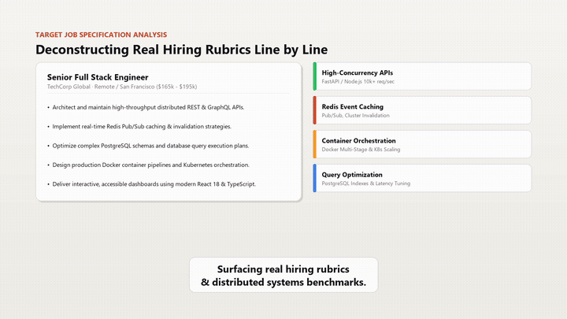
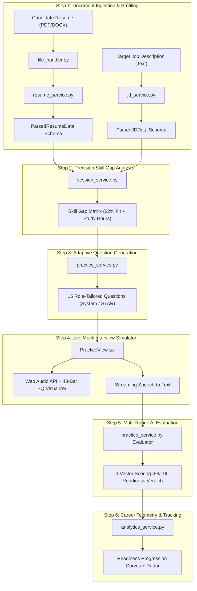
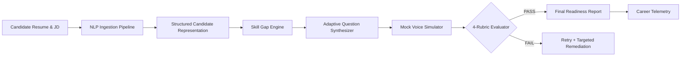

# InterviewAce
### Multi-Model AI Career Acceleration Platform for Resume Analysis, Skill Gap Profiling & Autonomous Mock Interviews

> **InterviewAce** is an enterprise-ready, multi-model AI preparation platform that transforms raw candidate resumes and target job descriptions into precision skill gap matrices, role-tailored technical & behavioral questions, and real-time interactive voice mock interviews with deterministic multi-rubric scoring.

**Hackathon-ready differentiator** — *Other interview prep tools ask generic trivia or hallucinate vague feedback. InterviewAce benchmarks candidate experience against real enterprise hiring requirements, routes across 4 state-of-the-art LLMs (Gemini, OpenAI, Claude, Groq) with zero-failure fallbacks, and scores every spoken answer against a 4-dimensional rubric (Technical Depth, STAR Delivery, System Architecture, Communication Clarity) to deliver measurable interview readiness.*

[](https://python.org)
[](https://fastapi.tiangolo.com)
[](https://react.dev)
[](https://vitejs.dev)
[](https://mongodb.com)
[](https://github.com)
[](https://opensource.org/licenses/MIT)
[](#-hackathon-attribution)

---

## 🎬 Demo Video Walkthrough (3-Minute Full HD)

[](https://github.com/Abhiram-1317/InterviewAce-Preparation/blob/main/brag-output/launch-video.mp4)

> 🔊 **Click the preview image above to open the video with full audio and playback controls!**

- 🎬 [**Watch Master Walkthrough with Audio & Controls (`launch-video.mp4`)**](https://github.com/Abhiram-1317/InterviewAce-Preparation/blob/main/brag-output/launch-video.mp4)
- 🎥 [**Watch Clean Video (`launch-video-clean.mp4`)**](https://github.com/Abhiram-1317/InterviewAce-Preparation/blob/main/brag-output/launch-video-clean.mp4)
- 📝 [**Subtitles (SRT)**](brag-output/captions.srt) | [**Subtitles (WebVTT)**](brag-output/captions.vtt)

| Technical Specification | Production Detail |
|:---|:---|
| **Duration** | **3:09 min** (189.5 seconds / 5,686 frames) |
| **Resolution** | 1920×1080 Full HD (16:9 Landscape) @ 30.0 fps |
| **Voice-Over Engine** | Microsoft Edge Neural Audio (`en-US-GuyNeural`) @ 24kHz |
| **Audio Mix & Normalization** | Dual-stem mix (Voice + Ambient Synthbed) sidechain-ducked to −14 LUFS |
| **Caption Synchronization** | Word-boundary synchronized karaoke caption capsules |
| **Video Encode** | H.264 High Profile, yuv420p, CRF 18 |

#### 6-Beat Storyboard Breakdown
1. **The Hook (0:00 – 0:38)**: Identifies the core candidate problem (endless generic LeetCode grinding) and introduces InterviewAce.
2. **Intelligent Ingestion (0:38 – 1:08)**: Live deconstruction of resumes (PDF/DOCX) and target Job Descriptions into structured competencies.
3. **Skill Gap Profiling (1:08 – 1:38)**: Visual alignment gauge (82% fit), partitioned into Strong Matches, Partials, and Red Gaps with study hours.
4. **Adaptive AI Mock Simulator (1:38 – 2:10)**: Dynamic 15-question synthesis and real-time voice interview with 48-bar audio waveform and live STT.
5. **Multi-Rubric Evaluation (2:10 – 2:38)**: 88/100 Readiness score decomposed into Technical Depth, STAR Delivery, Architecture, and Clarity.
6. **Career Telemetry & Multi-Model Gateway (2:38 – 3:09)**: Longitudinal readiness curves (64% → 76% → 88%) and zero vendor lock-in across Gemini, OpenAI, Claude, and Groq.

---

## 📋 Table of Contents

- [The Problem & The Solution](#-the-problem--the-solution)
- [Architecture Overview & Flow](#-architecture-overview--flow)
  - [Layered Architecture Diagram](#layered-architecture-diagram)
  - [End-to-End Candidate Lifecycle & Data Flow](#end-to-end-candidate-lifecycle--data-flow)
- [System Pipeline](#-system-pipeline)
- [Quick Start](#-quick-start)
- [Testing & System Verification](#-testing--system-verification)
- [CI/CD & Security](#-cicd--security)
- [Environment Variables](#%EF%B8%8F-environment-variables)
- [Project Statistics](#-project-statistics)
- [Project Structure](#-project-structure)
- [Security Features](#-security-features)
- [Why InterviewAce?](#-why-interviewace)
- [License](#-license)

---

## 💡 The Problem & The Solution

### The Broken Preparation Reality
- **90% of Technical Candidates Fail** not due to a lack of raw engineering ability, but because they prepare for the wrong things.
- Candidates spend **100+ hours blindly grinding 400 generic LeetCode problems** and trivial puzzles that hiring managers never actually evaluate.
- They walk into high-stakes interviews blind to the company's real production challenges: concurrency bottlenecks, caching layers, distributed architecture trade-offs, and structured STAR leadership delivery.

### The InterviewAce Solution
**InterviewAce** bridges the gap between your real experience and the target job description with an autonomous, precision-aligned preparation copilot:

1. **Intelligent Ingestion** — Deconstructs candidate resumes (PDF/DOCX) alongside target Job Descriptions into structured technical competencies and hiring rubrics.
2. **Precision Skill Gap Matrix** — Calculates an instant **Role Alignment Score (e.g., 82% Fit)**, highlighting verified strengths (green), adjacent tools (amber), and critical gaps (red) with estimated study hours (e.g., *Docker ~4h, Redis ~2h*)—saving **20+ hours of wasted study**.
3. **Adaptive 15-Question Engine** — Dynamically synthesizes high-signal architecture, concurrency, coding, and behavioral STAR questions focused on candidate weak spots.
4. **Live Mock Interview Simulator** — Realistic timed interview session with Web Audio API recording, 48-bar dynamic equalizer waveform visualizer, and streaming speech-to-text.
5. **Multi-Rubric AI Evaluation** — Grades spoken responses across 4 dimensions (Technical Depth, STAR Delivery, System Architecture, Clarity), yielding a composite **88/100 Readiness Score** with exemplar answers.
6. **Multi-Model Intelligence** — Zero vendor lock-in across Google Gemini, OpenAI GPT-4o, Anthropic Claude 3.5 Sonnet, and Groq LPU.

---

## 🏗 Architecture Overview & Flow

### Key Design Principles

| Principle | Implementation |
|:---|:---|
| **Model-Agnostic Gateway** | Dynamic runtime dispatch across Gemini 1.5/2.5, OpenAI GPT-4o, Claude 3.5 Sonnet, and Groq Llama 3.3 70B with graceful fallback. |
| **Deterministic Skill Gap Matrix** | Tri-tier semantic matching (Strong, Partial, High-Priority Gap) with weighted confidence scoring and estimated study time. |
| **Multi-Rubric Evaluation** | Evaluates 4 distinct scoring vectors (Technical Depth, STAR Delivery, System Architecture, Communication Clarity) out of 100 with actionable feedback. |
| **Reactive Real-Time Audio** | In-browser Web Audio API recorder with 48-bar frequency visualizer and real-time STT streaming. |
| **Stateless Document Parsing** | Resumes and JDs are processed in-memory, parsed into Pydantic models, and stored without persistent disk bloat. |
| **Zero Vendor Lock-In** | Users can bring their own API keys, toggle models in real-time, or rely on built-in platform defaults. |

### Layered Architecture Diagram

```
┌────────────────────────────────────────────────────────────────────────────────────────┐
│                          INTERVIEWACE PLATFORM ARCHITECTURE                            │
│                                                                                        │
│  [ PRESENTATION TIER ] React 18 + Vite 6 + TailwindCSS + Web Audio API                 │
│  ┌───────────────────────┐  ┌───────────────────────┐  ┌────────────────────────────┐  │
│  │ Resume & JD Ingestion │  │ Skill Gap Matrix View │  │ Live Mock Interview Room   │  │
│  │ (Drag-Drop / Parser)  │  │ (Fit %, Chip Filters) │  │ (48-Bar EQ + STT + Timer)  │  │
│  └───────────┬───────────┘  └───────────┬───────────┘  └─────────────┬──────────────┘  │
│              │                          │                            │                 │
│              └──────────────────────────┼────────────────────────────┘                 │
│                                         ▼ (Async REST / JSON Payloads)                 │
│  [ API GATEWAY TIER ] FastAPI + Pydantic v2 + OAuth2 JWT Bearer Guards                 │
│  ┌───────────────┬────────────────┬───────────────┬───────────────┬────────────────┐   │
│  │ /auth         │ /resumes       │ /jd           │ /sessions     │ /practice      │   │
│  │ Registration  │ File Parsing   │ Target Specs  │ Match Engine  │ Room Simulator │   │
│  └───────┬───────┴────────┬───────┴───────┬───────┴───────┬───────┴────────┬───────┘   │
│          │                │               │               │                │           │
│          ▼                ▼               ▼               ▼                ▼           │
│  [ DOMAIN SERVICES TIER ] Business Logic & Orchestration                               │
│  ┌───────────────┐ ┌──────────────┐ ┌──────────────┐ ┌──────────────┐ ┌──────────────┐ │
│  │ Resume Parser │ │ JD Profiling │ │ Skill Gap    │ │ Adaptive Q   │ │ Multi-Rubric │ │
│  │ & Normalizer  │ │ & Extractor  │ │ Matrix Core  │ │ Synthesizer  │ │ Evaluator    │ │
│  └───────┬───────┘ └──────┬───────┘ └──────┬───────┘ └──────┬───────┘ └──────┬───────┘ │
│          │                │                │                │                │         │
│          └────────────────┼────────────────┼────────────────┼────────────────┘         │
│                           ▼                ▼                ▼                          │
│  [ MULTI-MODEL AI GATEWAY ] Zero Vendor Lock-In & Auto-Fallback Backbone               │
│  ┌─────────────────┬─────────────────┬───────────────────┬──────────────────┐          │
│  │  Google Gemini  │  OpenAI GPT-4o  │  Claude 3.5       │  Groq LPU        │          │
│  │  (Flash / Pro)  │  (Enterprise)   │  (Sonnet)         │  (Llama 3.3 70B) │          │
│  └─────────────────┴─────────────────┴───────────────────┴──────────────────┘          │
│                                           │                                            │
│                                           ▼                                            │
│  [ DATA PERSISTENCE TIER ] Motor AsyncIO MongoDB                                       │
│  ┌──────────────────────────────────────────────────────────────────────────┐          │
│  │ Collections: users, resumes, job_descriptions, sessions, practices,     │          │
│  │              analytics_history                                           │          │
│  └──────────────────────────────────────────────────────────────────────────┘          │
└────────────────────────────────────────────────────────────────────────────────────────┘
```

### End-to-End Candidate Lifecycle & Data Flow



---

## 🔄 System Pipeline



1. **Ingestion** — `file_handler.py` fingerprints, sanitizes, and extracts text from multi-format notes (PDF/DOCX) & JDs in-memory.
2. **NLP Extraction** — Competency extraction, experience quantification, assertion typing, and typed Pydantic candidate schema build.
3. **Skill Gap Engine** — Tri-tier semantic matching (Strong, Partial, Gap) with confidence weights and study hour estimations.
4. **Question Synthesis** — Multi-model AI gateway dynamically synthesizes 15 role-tailored technical, architecture, and STAR questions.
5. **Mock Simulator** — Web Audio API captures microphone audio with a 48-bar dynamic visualizer and real-time speech-to-text.
6. **Rubric Evaluation** — 4-vector rubric grading (Depth, STAR, Architecture, Clarity) with remediation drills and telemetry trace.

---

## 🚀 Quick Start

### 1. One-Click Launch (Windows)
Double-click [**`start_interviewace.bat`**](start_interviewace.bat) from the project root. This automatically activates the backend virtual environment, starts FastAPI on `http://localhost:8000`, starts the React frontend on `http://localhost:3000`, and opens health monitoring.

---

### 2. Manual Quick Start

#### Prerequisites
- **Python**: 3.11 or 3.12
- **Node.js**: 18+ (with npm)
- **MongoDB**: Local MongoDB instance (`mongodb://localhost:27017`) or MongoDB Atlas URI

#### Unified Runner (Both Services)
```bash
python scripts/run_all.py
```

#### Individual Service Setup

**Backend (FastAPI)**:
```bash
cd backend
python -m venv venv
.\venv\Scripts\activate          # Windows: .\venv\Scripts\activate | macOS/Linux: source venv/bin/activate
pip install -r requirements.txt
python run.py
```
> API runs on **`http://localhost:8000`** | Swagger Docs at **`http://localhost:8000/docs`**.

**Frontend (React 18 + Vite)**:
```bash
cd frontend
npm install
npm run dev
```
> App runs on **`http://localhost:3000`**.

---

## 🧪 Testing & System Verification

### Automated 12-Stage Journey Verification (`scripts/verify_all.py`)
Run the comprehensive end-to-end verification suite:

```bash
python scripts/verify_all.py
```

The runner simulates the complete candidate lifecycle across 12 distinct stages:
1. **Health Check** — API liveness & MongoDB ping.
2. **User Registration** — Candidate account creation.
3. **OAuth2 JWT Authentication** — Bearer token generation & verification.
4. **Profile Verification** — `/auth/me` identity validation.
5. **Job Description Ingestion** — Parsing job specs into competencies.
6. **Resume Extraction** — PDF ingestion & technical skill categorization.
7. **Skill Gap Profiling** — Cross-referencing competencies & fit calculation.
8. **Adaptive Question Synthesis** — 15 role-specific questions generated.
9. **Practice Session Init** — Timed mock room setup.
10. **Question Delivery** — Fetching question with scoring criteria.
11. **Answer Grading** — 4-rubric scoring (Technical, STAR, System, Clarity).
12. **Telemetry Verification** — Progression curves & radar analytics.

### Unit & Integration Tests
```bash
# Run pytest across the backend
cd backend
pytest -v

# Frontend production bundle check
cd ../frontend
npm run build
```

---

## ⚙️ Environment Variables

Configure the following variables in `backend/.env`:

| Variable | Default | Description |
|:---|:---|:---|
| `PROJECT_NAME` | `InterviewAce API` | Application label displayed in OpenAPI documentation. |
| `VERSION` | `1.0` | API version string. |
| `MONGODB_URI` | `mongodb://localhost:27017` | MongoDB connection URI (local instance or MongoDB Atlas). |
| `DATABASE_NAME` | `interviewace` | Database name for candidate profiles, sessions, and telemetry. |
| `DEFAULT_AI_PROVIDER` | `gemini` | Default LLM provider (`gemini`, `openai`, `anthropic`, `groq`). |
| `GEMINI_API_KEY` | `""` | Google AI Studio API key. |
| `GEMINI_MODEL` | `gemini-1.5-flash` | Gemini model variant (`gemini-1.5-flash`, `gemini-1.5-pro`, `gemini-2.0-flash`). |
| `OPENAI_API_KEY` | `""` | OpenAI API key. |
| `OPENAI_MODEL` | `gpt-4o-mini` | OpenAI model variant (`gpt-4o-mini`, `gpt-4o`). |
| `ANTHROPIC_API_KEY` | `""` | Anthropic Claude API key. |
| `ANTHROPIC_MODEL` | `claude-3-5-sonnet-20241022` | Claude model variant. |
| `GROQ_API_KEY` | `""` | Groq Cloud API key for ultra-fast LPU inference. |
| `GROQ_MODEL` | `llama-3.3-70b-versatile` | Groq Llama model variant. |
| `SECRET_KEY` | *auto-generated* | Secret key used for signing JWT authentication tokens. |
| `ALGORITHM` | `HS256` | JWT signing algorithm. |
| `ACCESS_TOKEN_EXPIRE_MINUTES` | `1440` | JWT token lifetime (default: 24 hours). |
| `UPLOAD_DIR` | `./uploads` | Directory for temporary resume uploads. |
| `MAX_FILE_SIZE_MB` | `10` | Maximum file upload size limit in megabytes. |
| `FRONTEND_URL` | `http://localhost:3000` | Allowed CORS origin for the React frontend application. |

---

## 🔄 CI/CD & Security

### Automated Code Quality Checks
Run these commands locally prior to committing:

```bash
# Backend linting and formatting
black --check backend/app/
flake8 backend/app/

# Frontend linting
cd frontend
npm run lint

# Security audit
pip-audit
npm audit
```

---

## 📊 Project Statistics

```
┌─────────────────────────────────┬───────────┬───────────────┐
│ Module                          │ Files     │ Lines of Code │
├─────────────────────────────────┼───────────┼───────────────┤
│ backend/app/models/             │ 8         │ 880+          │
│ backend/app/routes/             │ 7         │ 1,440+        │
│ backend/app/services/           │ 7         │ 1,460+        │
│ backend/app/utils/              │ 4         │ 970+          │
│ backend/app/ (core & main)      │ 3         │ 200+          │
│ frontend/src/views/             │ 19        │ 4,620+        │
│ frontend/src/components/        │ 10        │ 690+          │
│ frontend/src/ (styles & core)   │ 6         │ 500+          │
├─────────────────────────────────┼───────────┼───────────────┤
│ TOTAL PRODUCTION CODEBASE       │ 64        │ ~10,760+      │
└─────────────────────────────────┴───────────┴───────────────┘
```

- **Supported AI Providers**: 4 (Google Gemini, OpenAI, Anthropic Claude, Groq LPU)
- **Evaluation Rubrics**: 4 Dimensions (Technical Depth, STAR Delivery, System Architecture, Communication Clarity)
- **System Verification Stages**: 12 Automated Journey Steps verified
- **3-Minute Master Walkthrough**: 189.5 seconds (5,686 frames) rendered at Full HD 1080p @ 30fps

---

## 📁 Project Structure

```
InterviewAce_tricity_hackthon/
├── backend/                          # FastAPI Async Backend
│   ├── app/
│   │   ├── config.py                 # Pydantic v2 application configuration
│   │   ├── database.py               # Motor async MongoDB client & pool
│   │   ├── main.py                   # FastAPI app with CORS & router mounts
│   │   ├── models/                   # Pydantic data models & schemas
│   │   │   ├── analytics.py          # Longitudinal progress & score radar
│   │   │   ├── answer.py             # STAR format & evaluation models
│   │   │   ├── jd.py                 # Job description & skill requirements
│   │   │   ├── practice.py           # Practice session & rubric scoring
│   │   │   ├── question.py           # Tailored question bank models
│   │   │   ├── resume.py             # Parsed resume schema & skill arrays
│   │   │   ├── session.py            # Skill gap matrix & fit analysis
│   │   │   └── user.py               # User authentication & token schemas
│   │   ├── routes/                   # FastAPI route controllers
│   │   │   ├── ai.py                 # AI provider management & connection tests
│   │   │   ├── analytics.py          # Performance metrics & radar data
│   │   │   ├── auth.py               # JWT registration, login & profile
│   │   │   ├── jd.py                 # Job description parsing endpoints
│   │   │   ├── practice.py           # Question delivery & answer evaluation
│   │   │   ├── resume.py             # Resume file upload & parsing
│   │   │   └── session.py            # Preparation sessions & skill gaps
│   │   ├── services/                 # Business logic & AI orchestration
│   │   │   ├── ai_provider_service.py# Multi-model LLM router (Gemini/OpenAI/Claude/Groq)
│   │   │   ├── analytics_service.py  # Trend tracking & readiness scoring
│   │   │   ├── jd_service.py         # JD skill extraction & role profiling
│   │   │   ├── practice_service.py   # Adaptive 15-question generation & scoring
│   │   │   ├── resume_service.py     # Resume extraction & skill categorization
│   │   │   ├── session_service.py    # Skill gap matching & hours estimation
│   │   │   └── user_service.py       # Authentication & user profile CRUD
│   │   └── utils/                    # Shared helper modules
│   │       ├── dependencies.py       # Auth guards & database injection
│   │       ├── file_handler.py       # PDF/DOCX multi-format text extraction
│   │       ├── llm.py                # Structured JSON prompt extraction
│   │       └── security.py           # Bcrypt hashing & JWT signing
│   ├── requirements.txt              # Backend Python dependencies
│   ├── run.py                        # Uvicorn launcher
│   └── verify_all.py                 # 12-stage end-to-end verification script
├── frontend/                         # React 18 + Vite Frontend
│   ├── src/
│   │   ├── components/               # Reusable UI components
│   │   │   ├── DimensionScoresChart.jsx # Multi-rubric dimension score visualizer
│   │   │   ├── EvaluationModal.jsx   # Detailed question evaluation popup
│   │   │   ├── Navbar.jsx            # Top navigation with user status
│   │   │   ├── ScoreGauge.jsx        # Animated circular score gauge
│   │   │   ├── SkillRadarChart.jsx   # Competency radar visualizer
│   │   │   ├── Timer.jsx             # Interview question response timer
│   │   │   └── VoiceRecorder.jsx     # 48-bar audio EQ & real-time STT
│   │   ├── views/                    # Application pages & workflows
│   │   │   ├── AnalyticsView.jsx     # Telemetry & readiness dashboard
│   │   │   ├── AuthView.jsx          # Login & registration tabs
│   │   │   ├── DashboardView.jsx     # Recent sessions & readiness overview
│   │   │   ├── FeedbackView.jsx      # Multi-rubric score breakdown & exemplars
│   │   │   ├── JdInputView.jsx       # Job description pasting & parsing
│   │   │   ├── LandingView.jsx       # Marketing & feature showcase
│   │   │   ├── PracticeView.jsx      # Interactive timed mock interview room
│   │   │   ├── ResumeUploadView.jsx  # Drag-and-drop resume ingestion
│   │   │   ├── SettingsView.jsx      # Multi-LLM provider configuration
│   │   │   └── SkillGapView.jsx      # Color-coded alignment matrix
│   │   ├── App.jsx                   # React Router route registry
│   │   ├── main.jsx                  # React DOM entrypoint
│   │   └── index.css                 # Glassmorphic Tailwind CSS design system
│   ├── package.json                  # Node.js dependencies
│   └── vite.config.js                # Vite build configuration
├── scripts/                          # Automation & Testing Suite
│   ├── run_all.py                    # Unified startup orchestrator (Backend + Frontend)
│   ├── verify_all.py                 # 12-stage automated journey test runner
│   └── start_interviewace.bat        # Windows launcher script
├── brag-output/                      # Hackathon Video Deliverables
│   ├── launch-video.mp4              # 3-Minute Master Walkthrough (1080p, Burned Captions)
│   ├── launch-video-clean.mp4        # 3-Minute Clean Video without Burned Captions
│   ├── captions.srt                  # SubRip subtitle track
│   ├── captions.vtt                  # WebVTT subtitle track
│   ├── brag-plan.md                  # Complete 11-scene storyboard & production plan
│   └── brag-share.md                 # Hackathon submission write-up & social copy
├── start_interviewace.bat            # 1-Click root launcher for Windows
├── .gitignore                        # Git exclusion rules
├── LICENSE                           # MIT License
└── README.md                         # This comprehensive document
```

---

## 🔐 Security Features

- **Client-Side API Key Vault**: Users can supply their own LLM API keys via browser settings; credentials are never logged or stored insecurely.
- **In-Memory Document Extraction**: Uploaded resumes and job descriptions are parsed in-memory with temporary files cleanly removed post-extraction.
- **Stateless Model Interfacing**: LLM prompt payloads contain only sanitized technical competencies, omitting personal identifiers where appropriate.
- **Tamper-Resistant Authentication**: Passwords hashed using bcrypt with salt rounds; authentication enforced via signed HS256 JWT bearer tokens.
- **Strict Data Isolation**: Candidate sessions, practice attempts, and analytics are strictly segregated by user ID in MongoDB.

---

## 🏆 Why InterviewAce?

| Feature / Capability | InterviewAce | LeetCode / HackerRank | Generic ChatGPT Wrappers | Human Mock Services |
|:---|:---|:---|:---|:---|
| **Role-Specific Tailoring** | ✅ Exact match against target JD | ❌ Generic algorithm puzzles | ⚠️ Requires extensive manual prompting | ⚠️ Inconsistent interviewer quality |
| **Skill Gap Matrix** | ✅ Quantified fit % & study hours | ❌ None | ❌ Ad-hoc, unstructured text | ❌ Subjective impressions |
| **Real-Time Voice Mock** | ✅ Web Audio EQ + live STT | ❌ Text-only code editor | ❌ Chat text only | ✅ Spoken conversation |
| **Multi-Rubric Evaluation** | ✅ 4 distinct vectors out of 100 | ❌ Binary pass/fail test cases | ⚠️ Vague, generic praise | ⚠️ Vague, unstandardized notes |
| **Multi-Model Routing** | ✅ Gemini, OpenAI, Claude, Groq | ❌ N/A | ❌ Locked to a single provider | ❌ N/A |
| **Longitudinal Telemetry** | ✅ Readiness curve & radar metrics | ⚠️ Solved problem count only | ❌ None | ❌ None |
| **Cost & Availability** | ✅ Free / Open Source, 24/7 | ⚠️ Subscription paywalls | ⚠️ Subscription paywalls | ❌ $150 – $300 per session |

---

## 📄 License & Hackathon Attribution

### License
This project is licensed under the **MIT License** — see the [LICENSE](LICENSE) file for details.

### Hackathon Attribution
Built with ❤️ for **Tricity Hackathon 2026** 🚀  
*Interview preparation isn't about guesswork — it's about precision alignment.*
